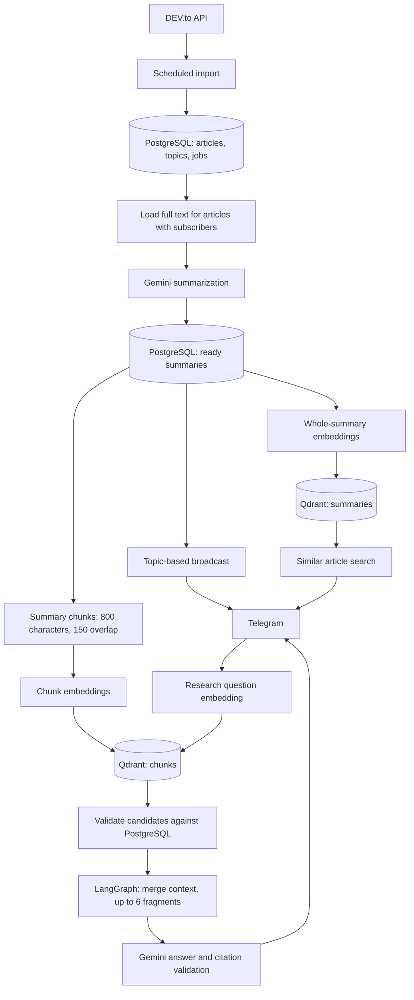

# Telegram News Assistant

AI-powered Telegram news assistant with summarization, semantic search and RAG. Built with NestJS, PostgreSQL, Gemini and Qdrant.

Follow technical topics, receive concise summaries, discover related publications, and ask questions about your news archive. The bot imports DEV.to articles and summarizes their full text with Gemini. The current Telegram interface and generated answers are in Russian.

## Features and commands

- Topic subscriptions: 30 initially active topics; newly discovered topics are inactive by default.
- Summaries and broadcasts for articles with active subscribers.
- Original article links and up to three similar articles displayed as title buttons.
- Archive research through LangGraph, with citations and buttons to open saved summaries.
- Separate Qdrant collections for whole-summary search and chunk-based research.

| Command | Purpose |
| --- | --- |
| `/start` | Show the main keyboard |
| `/topics` | Choose topics to follow |
| `/my_subscriptions` | List subscriptions |
| `/unsubscribe` | Choose a topic to unfollow |
| `/latest` | Show up to five latest ready summaries matching subscriptions |
| `/research <question>` | Ask about the indexed archive |
| `/research` | Open a question prompt |
| `/help` | Show help |

## Short walkthrough

This is a usage walkthrough, not a recording of a live session:

1. Send `/start`, then `/topics`, and subscribe to `python`.
2. Receive a matching summary after import and processing. Use **Оригинал статьи** (Original article) to read the source.
3. Press **Найти похожие новости** (Find similar news), then select a title to open its summary.
4. Send `/research Какие подходы к AI-агентам описаны в архиве?` or press **Исследовать тему** (Research a topic).
5. Read the answer and references such as `[2512]`; open sources using the title buttons below it.

An empty archive needs time to populate. Research uses indexed summaries, not live web search.

## Architecture



Chunk sizes use Unicode code points. Overlapping neighboring chunks are merged before selecting up to six context fragments. Research is a single retrieval pass without conversation memory or iterative investigation. Citation validation checks IDs and structure, not factual correctness.

## Local setup

Requirements: Node.js 24, npm, Docker, a Telegram bot token, and a Google API key with access to the selected generation and embedding models. Use a separate development bot to avoid competing with production polling.

Commands below use Bash or Git Bash:

```bash
git clone https://github.com/hmax24/tg_bot_news.git
cd tg_bot_news
npm ci
cp .env.example .env
```

Edit `.env`: fill in `TELEGRAM_BOT_TOKEN`, `GOOGLE_API_KEY`, and exact model IDs available to your Google API project. `GEMINI_SUMMARY_MODEL` is used for both summaries and research answers. Never commit `.env`.

Start local dependencies using the development credentials from `.env.example`:

```bash
docker run -d --name tg-news-postgres -p 127.0.0.1:5432:5432 -e POSTGRES_USER=tg_bot_app -e POSTGRES_PASSWORD=local_dev_only -e POSTGRES_DB=tg_bot_news -v tg_news_postgres:/var/lib/postgresql/data postgres:17-bookworm
docker run -d --name tg-news-qdrant -p 127.0.0.1:6333:6333 -v tg_news_qdrant:/qdrant/storage qdrant/qdrant:v1.19.1
```

If the names or ports are occupied, reuse your existing services or choose different ports and update `.env`. These credentials are for local development only. Named volumes preserve data when containers stop.

Wait until both checks succeed:

```bash
docker exec tg-news-postgres pg_isready -U tg_bot_app -d tg_bot_news
curl http://127.0.0.1:6333/readyz
```

Apply migrations, then start the app:

```bash
npm run migration:run
npm run schema:check
npm run start:dev
```

Open the bot and send `/start`. Telegram uses polling; no public inbound HTTP endpoint is required. Nest listens on port 3000 by default.

### Enable AI processing

The example disables paid background processing. After configuring credentials, enable these settings and restart:

```dotenv
NEWS_CONTENT_PROCESSING_ENABLED=true
NEWS_INDEXING_ENABLED=true
NEWS_INGESTION_ENABLED=true
```

| Job | Schedule | Work per run |
| --- | --- | --- |
| Import | Every 10 minutes | First page, up to 21 articles |
| Summarization | Every 5 seconds | One eligible pending article |
| Broadcast | Every 5 seconds | One pending broadcast |
| Whole-summary indexing | Every 30 seconds | One eligible job |
| Chunk ingestion | Every minute at second 15 | Prepare and process one eligible job |

Overlapping scheduled executions of the same job are skipped within one process. Older eligible articles can also be processed, consuming API credits. Flags control scheduled AI jobs, not manual scripts or user-triggered research. Import remains enabled.

### Configuration and diagnostics

[`.env.example`](.env.example) lists application settings. A host app uses `127.0.0.1`; an app inside Compose uses service names, such as `DB_HOST=db` and `QDRANT_URL=http://qdrant:6333`.

Use different collection names for summaries and chunks. Changing the embedding model, dimensions, or chunking settings requires a deliberate new collection and reindexing. Do not mix models in an existing collection.

Manual diagnostics can call paid APIs:

```bash
npx ts-node src/news-indexing/index-once.ts
npx ts-node src/ingestion/ingest-once.ts
npx ts-node src/research/research-once.ts "Как в архиве описаны AI-агенты?"
```

## Tests and build

```bash
npx tsc --noEmit
npm test -- --runInBand
npm run build
```

Without `TEST_DATABASE_URL`, PostgreSQL integration tests are skipped. Follow [the disposable database instructions](test/integration/README.md) to test migrations and repositories. Never use production. Unit tests mock external APIs and do not establish live provider availability.

Additional database notes: [docs/database.md](docs/database.md) (Russian).

## Deployment

[GitHub Actions](.github/workflows/deploy.yml) runs on `main`: build, test with PostgreSQL, publish a commit-tagged image to GHCR, and deploy over SSH. The current target is `ghcr.io/hmax24/tg_bot_news`; forks must change image paths in the workflow and scripts.

Actions secrets: `SSH_HOST`, `SSH_USER`, `SSH_PRIVATE_KEY`, `SSH_KNOWN_HOSTS`. Publication uses the workflow's `GITHUB_TOKEN`.

The server requires Docker Compose, `~/tg-bot-news/compose.yaml`, `.env`, persistent PostgreSQL/Qdrant volumes, registry pull access, and passwordless sudo for the deploy user's required Docker commands. The base Compose file is server-managed and not included here. Pass variables explicitly into the `app` service: Compose's `.env` alone does not inject them into a container.

[`scripts/deploy.sh`](scripts/deploy.sh) pulls the image, stops the app, backs up PostgreSQL, runs migrations, and starts the release. Deployment has downtime. Its HTTP check confirms Nest is listening, not that Telegram, import, or research work. Failed migrations do not automatically roll back the database. Verify logs and Telegram behavior after deployment.

## Status and limitations

This is a working application with known reliability gaps:

- Import checks primary and fallback DEV.to endpoints and rejects reported cache ages above 20 minutes. Both may fail; a missing `Age` does not prove freshness.
- No pagination or catch-up cursor: publications can be missed during downtime or high traffic.
- Failed jobs and interrupted `PROCESSING` jobs have no automatic recovery. One recipient error can interrupt a broadcast.
- Research has one shared in-process execution slot but no per-user usage quota. Public access can consume paid API credits.
- Only eligible summaries are indexed. Research uses summary chunks, not original full texts, and may answer incorrectly despite valid citations.
- PostgreSQL and Qdrant require persistent storage and sufficient resources. A 512 MB server is constrained; low idle usage is not a capacity guarantee.

The package is marked `UNLICENSED`. The NestJS template's author and license statements do not describe this application.
